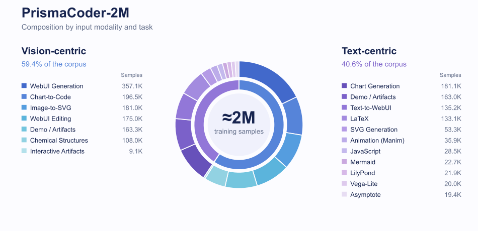
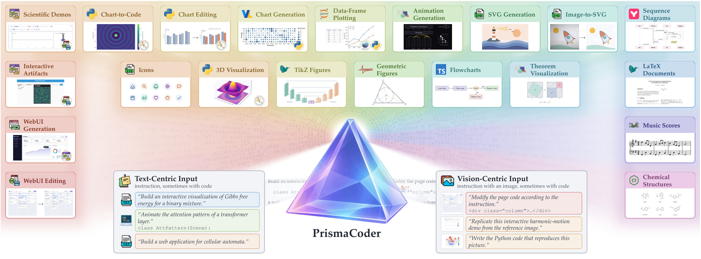

# PrismaCoder

<p align="center">
  
</p>

<p align="center">
  <strong>Pushing the Boundaries of Open Multimodal Code Intelligence<br>through Decomposed Rubric Synthesis</strong>
</p>

<p align="center">
  📄 <a href="https://arxiv.org/abs/2610.20538">Paper</a>&nbsp;&nbsp;|&nbsp;&nbsp;
  🌐 <a href="https://qiushisun.github.io/PrismaCoder-Home/">Homepage</a>&nbsp;&nbsp;|&nbsp;&nbsp;
  🤗 <a href="https://huggingface.co/papers/2610.20538">HF Paper</a>&nbsp;&nbsp;|&nbsp;&nbsp;
  🤗 <a href="https://huggingface.co/collections/QiushiSun/prismacoder">Models</a>&nbsp;&nbsp;|&nbsp;&nbsp;
  📚 <a href="https://huggingface.co/datasets/QiushiSun/PrismaCoder-2M">Dataset</a>
</p>

<p align="center">
  <a href="#overview">Overview</a> ·
  <a href="#models">Models</a> ·
  <a href="#dataset">Dataset</a> ·
  <a href="#getting-started">Getting started</a> ·
  <a href="#roadmap">Roadmap</a> ·
  <a href="#citation">Citation</a>
</p>

<a id="overview"></a>
## 🔍 Overview

PrismaCoder is a family of open multimodal code models for generating and editing charts, webpages, diagrams, documents, and animations from text or visual inputs.

Our data pipeline, PrismaForge, synthesizes a rubric for each instruction, combining reusable domain checks with task-specific requirements. It evaluates the program and its rendered output separately, then uses the same criteria to curate training data and reward reinforcement learning. The resulting PrismaCoder-2M corpus supports supervised fine-tuning of PrismaCoder-9B and PrismaCoder-35B-A3B, followed by rubric-based policy optimization.

The [project page](https://qiushisun.github.io/PrismaCoder-Home/) includes an interactive pipeline walkthrough, benchmark results, and generated examples. See the [paper](https://arxiv.org/abs/2610.20538) for the method and experiments.

<a id="models"></a>
## 🤗 Models

Both model sizes have supervised fine-tuning (SFT) and reinforcement learning (RL) variants. All releases are collected in the [PrismaCoder collection](https://huggingface.co/collections/QiushiSun/prismacoder).

| Model | Base model | Training | Weights |
|---|---|---|---|
| [PrismaCoder-9B](https://huggingface.co/QiushiSun/PrismaCoder-9B) | Qwen3.5-9B | SFT + RL | Available |
| [PrismaCoder-35B-A3B](https://huggingface.co/QiushiSun/PrismaCoder-35B-A3B) | Qwen3.5-35B-A3B | SFT + RL | Uploading |
| [PrismaCoder-9B-SFT](https://huggingface.co/QiushiSun/PrismaCoder-9B-SFT) | Qwen3.5-9B | SFT | Available |
| [PrismaCoder-35B-A3B-SFT](https://huggingface.co/QiushiSun/PrismaCoder-35B-A3B-SFT) | Qwen3.5-35B-A3B | SFT | Available |

<a id="dataset"></a>
## 📚 PrismaCoder-2M

[PrismaCoder-2M](https://huggingface.co/datasets/QiushiSun/PrismaCoder-2M) is an open corpus of visual-coding tasks curated with PrismaForge. It brings chart generation and reconstruction, web interfaces, interactive demos, vector graphics, scientific documents, chemical structures, and animation into a shared training corpus.

Vision-centric tasks use reference images, sometimes with code to edit; text-centric tasks start from an instruction, optionally with code. The corpus covers Python, HTML/CSS, JavaScript, SVG, LaTeX, Mermaid, Vega-Lite, LilyPond, Asymptote, and chemical-structure representations.

> Dataset upload is in progress. The [dataset page](https://huggingface.co/datasets/QiushiSun/PrismaCoder-2M) lists the currently available subsets.

<p align="center">
  
</p>

The distribution follows the [paper's dataset statistics](https://arxiv.org/html/2610.20538v1#S4.T1). Proportions are computed from its rounded sample counts.

<details>
<summary>Task examples across supported formats</summary>

<p align="center">
  
</p>

</details>

### Data sources and curation

| Source | What it contributes |
|---|---|
| Public visualization corpora | Plotting and graphics tasks in Python, SVG, Mermaid, and Vega-Lite |
| Scientific repositories and papers | GitHub plotting code and arXiv figures, with long scripts split into self-contained tasks using abstract syntax trees |
| Web pages and interactive demos | Layout examples from WebCode2M and MCD, plus tasks requiring interactive behavior |
| Symbolic and scientific content | PubChem molecular structures, compilable notation in LaTeX, Asymptote, and LilyPond, and Manim scenes seeded from 3Blue1Brown code |

Candidates first pass format-specific execution or rendering checks. PrismaForge then evaluates code and visual rubrics separately: low-scoring samples are discarded, intermediate samples are regenerated with feedback from failed criteria, and high-scoring samples are retained under domain-specific thresholds.

RL instructions are held out before SFT. Selection focuses on medium or hard tasks where the SFT model's rollouts receive different rubric scores, giving policy optimization a useful learning signal.

The released data tools include [format-specific execution and rendering checks](data_toolkit/README.md) and [multimodal algorithm data synthesis pipelines](data_toolkit/mm-algorithm/README.md).

<a id="getting-started"></a>
## ⚙️ Getting started

```bash
git clone https://github.com/QiushiSun/PrismaCoder.git
cd PrismaCoder
```

Each module documents its own dependencies, inputs, and commands. Start with the component you need:

| Component | What it provides | Guide |
|---|---|---|
| Rendering checks | Validate and render SVG, Mermaid, R, Asymptote, and TypeScript outputs | [Data toolkit](data_toolkit/README.md) |
| Multimodal algorithm data | Synthesize diagram-based problems, solve competition tasks, and augment seed data | [Algorithm pipelines](data_toolkit/mm-algorithm/README.md) |
| RL verification | Execute and score Python, SVG, and HTML rollouts from text-only prompts | [RL toolkit](rl_toolkit/README.md) |
| VisPlotBench | Execute generated code, judge rendered outputs, and aggregate results | [VisPlotBench evaluation](evaluation/VisPlotBench/README.md) |
| ChemDraw | Evaluate chemical structure recognition as image-to-SMILES prediction | [ChemDraw evaluation](evaluation/ChemDraw/README.md) |

### Data construction

The rendering checkers accept JSONL records and separate successful renders from failures. Each format includes sample inputs and setup instructions: [SVG](data_toolkit/svg/README.md), [Mermaid](data_toolkit/mermaid/README.md), [R](data_toolkit/r/README.md), [Asymptote](data_toolkit/asymptote/README.md), and [TypeScript](data_toolkit/typescript/README.md).

For multimodal algorithm data, use the [MMCode synthesis](data_toolkit/mm-algorithm/mmcode-pipeline/README.md), [competition solving](data_toolkit/mm-algorithm/competition-pipeline/solve-pipeline/README.md), [template generation](data_toolkit/mm-algorithm/competition-pipeline/newgen-pipeline/README.md), or [cross-source augmentation](data_toolkit/mm-algorithm/cross-aug-pipeline/README.md) pipeline. These workflows include seed samples and use a configured model API.

### Training

The paper uses full-parameter SFT and RL with the Megatron backend in ms-swift. The released [RL toolkit](rl_toolkit/README.md) provides per-rollout rewards and batch metrics for integration into a training loop. Its current verifiers cover text-only prompts for Python plotting, SVG, and HTML; training scripts and the PrismaForge rubric pipeline are tracked in the [roadmap](#roadmap).

### Evaluation

The [VisPlotBench guide](evaluation/VisPlotBench/README.md) covers environment setup, execution, judging, and aggregation. Its run commands expect prepared run bundles containing model generations and a `manifest.json`.

The [ChemDraw guide](evaluation/ChemDraw/README.md) includes a bundled test set and commands for evaluating an OpenAI-compatible model endpoint. Predictions are parsed with RDKit and scored for validity, canonical SMILES exact match, and molecular similarity.

<a id="roadmap"></a>
## 🚧 Open-source roadmap

Release status as of October 22, 2026.

### Code

- [x] Format-specific execution and rendering checks ([`data_toolkit/`](data_toolkit/README.md))
- [x] Multimodal algorithm data synthesis and augmentation ([`mm-algorithm/`](data_toolkit/mm-algorithm/README.md))
- [x] Text-only Python, SVG, and HTML reward verifiers ([`rl_toolkit/`](rl_toolkit/README.md))
- [x] [VisPlotBench](evaluation/VisPlotBench/README.md) and [ChemDraw](evaluation/ChemDraw/README.md) evaluation code
- [ ] PrismaForge rubric synthesis, scoring, and iterative data gating
- [ ] SFT and RL training scripts and configurations
- [ ] Model inference examples and additional benchmark evaluation scripts

### Data & models

- [x] [PrismaCoder-9B-SFT](https://huggingface.co/QiushiSun/PrismaCoder-9B-SFT) and [PrismaCoder-35B-A3B-SFT](https://huggingface.co/QiushiSun/PrismaCoder-35B-A3B-SFT) checkpoints
- [x] [PrismaCoder-9B](https://huggingface.co/QiushiSun/PrismaCoder-9B) checkpoint
- [ ] [PrismaCoder-35B-A3B](https://huggingface.co/QiushiSun/PrismaCoder-35B-A3B) checkpoint
- [ ] [PrismaCoder-2M](https://huggingface.co/datasets/QiushiSun/PrismaCoder-2M) dataset (Uploading)

<a id="citation"></a>
## 📃 Citation

If you use PrismaCoder, its data, or its tools, please cite:

```bibtex
@article{sun2026prismacoder,
  title={PrismaCoder: Pushing the Boundaries of Open Multimodal Code Intelligence through Decomposed Rubric Synthesis},
  author={Sun, Qiushi and Gong, Jingyang and Liu, Yang and Chen, Qiaosheng and Yin, Zhangyue and Huang, Zixian and Hu, Hanxu and Xiong, Jing and Xu, Fangzhi and Tan, Haochen and others},
  journal={arXiv preprint arXiv:2610.20538},
  year={2026}
}
```
